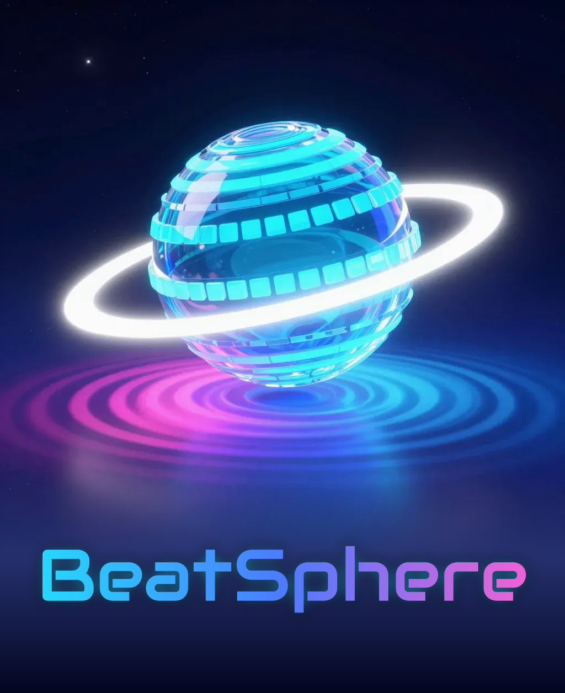

<p align="center">
  
</p>

<h1 align="center">BeatSphere</h1>

<p align="center">
  <b>A colorful, animated music player for Android that plays the music on your phone.</b>
</p>

<p align="center">
  <a href="https://ko-fi.com/rutgerdeveloper"></a>
  <a href="https://paypal.me/RutgerMunoz"></a>
  <a href="https://liberapay.com/rutger_munoz"></a>
</p>

<p align="center">
  BeatSphere is free. If you enjoy it, a donation helps keep it growing. 💜
</p>

---

## About

BeatSphere is an official music player app for Android. It finds every song on your phone
and plays it with a living, animated interface: covers, playlists, folders, mixes, wallpapers and color
styles, in your own language.

## Features

- **All your music, A–Z.** Finds songs anywhere on the phone, with search and letter shortcuts.
- **Covers everywhere.** Shows each song's album art, including art Android keeps hidden from other apps,
  and lets you pick your own cover from Photos, Drive or the Gallery.
- **Playlists, folders and mixes.** Create, rename, reorder and decorate playlists; browse by folder;
  play Shuffle all, Favorites, Recently played or Discover mixes.
- **Plays in the background.** Controls in the notification panel, on the lock screen and on headphones.
- **Make it yours.** Six color styles, fonts, wallpapers and smooth animations you can turn off.
- **28 languages.** Follows your phone's language, or choose one in Settings.

## Support BeatSphere

BeatSphere is built and maintained by one developer. If it brightens your day, you can support it here:

| | |
|---|---|
| ☕ **Ko-fi** | [ko-fi.com/rutgerdeveloper](https://ko-fi.com/rutgerdeveloper) |
| 💳 **PayPal** | [paypal.me/RutgerMunoz](https://paypal.me/RutgerMunoz) |
| 💛 **Liberapay** | [liberapay.com/rutger_munoz](https://liberapay.com/rutger_munoz) |

Donations are voluntary gifts and don't change the license (see section 8 of the [LICENSE](LICENSE)).

## Built with

- [Python](https://www.python.org/) and [Kivy](https://kivy.org/)
- [tinytag](https://github.com/tinytag/tinytag) for song details and covers
- [python-for-android](https://github.com/kivy/python-for-android) and Buildozer for the Android app

## Run on a computer

```bash
python -m venv .venv
.venv\Scripts\activate
pip install -r requirements.txt
python main.py
```

## Suggestions and contact

Ideas, bug reports and permission requests are welcome in
[GitHub Issues](https://github.com/RutgerMunoz/BeatSphere/issues).

Made by [Rutger Alexander Munoz](https://github.com/RutgerMunoz).

## License

BeatSphere is source-available, not open source. You may read the code and use the app for personal use;
anything else needs the author's written consent. See [LICENSE](LICENSE) for the full terms.
